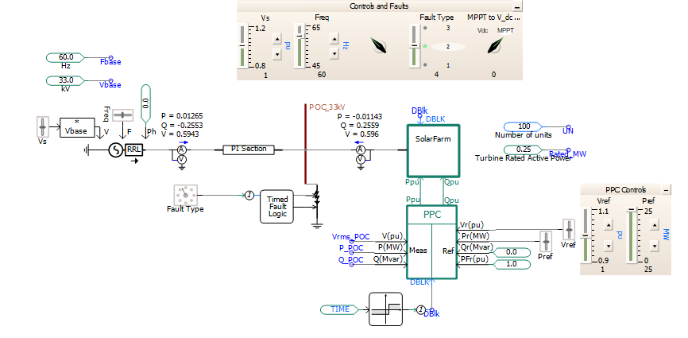
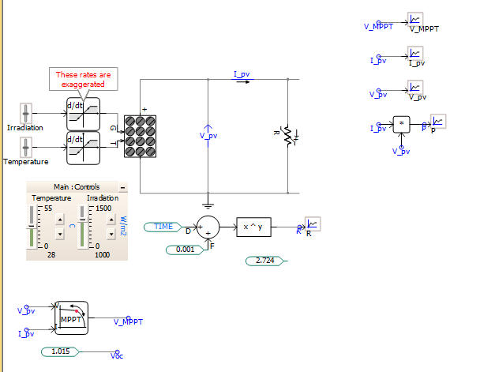

# PSCAD solar farm example: DENSYS study and static review

**Purpose.** This private coursework repository documents a PSCAD solar farm exercise for a DENSYS master's portfolio. It is based on Manitoba Hydro International's (MHI) [Simple Solar Farm example and 2019 technical guide](https://www.pscad.com/knowledge-base/article/521), also discussed in a [PSCAD lecture video](https://www.youtube.com/watch?v=ZBd5q_PqLRQ&t=340s). MHI authored the underlying example and guide.

## Engineering system

MHI's guide describes a grid-connected PV farm with a power plant controller (PPC) at the point of connection (POC), PV array, boost converter with DC-voltage or maximum-power-point-tracking (MPPT) control, DC/AC voltage-source converter, filter/damper, transformer, phase-locked loop (PLL), and inverter controls. A scaling interface represents 100 inverter units. The guide's nominal PV unit has a maximum power of about 0.25 MW at 1,000 W/m² irradiance and 28 °C (pp. 1, 3–4, 6–13). The PPC can use POC-voltage, power-factor, or fixed-reactive-power control; the inverter has active/reactive current priority, frequency droop, and voltage ride-through settings (pp. 3, 7, 14–16).

The local workspace `model/SolarFarm.pswx` references two PSCAD v4.6.3 cases:

| Case | Role | Declared settings |
| --- | --- | --- |
| [`SolarFarm_Model.pscx`](model/SolarFarm_Model.pscx) | Main grid-connected farm and PPC study | 20 s duration, 15 µs time step, 495 µs sample step |
| [`PV_Array_250kW.pscx`](model/PV_Array_250kW.pscx) | PV-array characteristic sweep | 2.5 s duration, 50 µs time step and sample step |

The working main case was renamed from MHI's `SimpleSolarFarm.pscx`; internal project and component names were changed accordingly in an earlier assistant session. Its electrical parameters and logic were not deliberately altered. The PV case matches the official source copy. Original downloaded files remain in `source/` on the original computer; that duplicate folder is excluded from this repository.

## Model views

These PSCAD screenshots were supplied for this coursework repository. They show the model layout and controls; they are not simulation plots or proof of a successful run.

**Solar farm main case:** grid equivalent, point of connection, fault logic, solar-farm module, and plant controller.

**PV array case:** irradiation and temperature inputs, array characteristic sweep, and MPPT-related signals.

## Reported scenarios and findings

The MHI guide reports a PV-array sweep producing approximately 0.25 MW maximum power, 1.015 kV open-circuit voltage, and 0.325 kA short-circuit current (p. 4, Fig. 6). It also shows a farm response with a load connection at 3.5 s and an AB-to-ground fault at the POC at 5 s; for the illustrated PPC voltage-control, inverter active-power-control, and boost MPPT configuration, the farm injects reactive power during the fault (p. 17, Fig. 23). 

## Repository contents and dependencies

| Location | Role |
| --- | --- |
| [`model/`](model/) | Working PSCAD workspace and two cases; contains embedded custom components |
| `source/` (local only) | Official archive and extracted source copies, retained outside the repository for provenance |
| [`docs/Official_Simple_Solar_Farm.pdf`](docs/Official_Simple_Solar_Farm.pdf) | MHI's 20-page technical guide, in this private repository |
| [`docs/STATIC_AUDIT.md`](docs/STATIC_AUDIT.md) | Detailed file inventory, evidence, path map, discrepancies, and publication risks |
| [`docs/Resources.md`](docs/Resources.md) | Links to the source example and related resources |
| [`docs/figures/`](docs/figures/) | Supplied PSCAD schematic screenshots; no run results |
| `diagnostics/` (local only) | Earlier compiler diagnostic and generated build remnants; excluded from the repository, not study results |
| [`PORTFOLIO.md`](PORTFOLIO.md) | Cautious portfolio/CV/LinkedIn draft |

The files declare PSCAD X4 v4.6.3. This computer has PSCAD Free 5.1 and GFortran 13.2 according to a prior local diagnostic, but model compatibility, compiler selection in PSCAD, licensing limits, and a successful build of these cases remain **unconfirmed**. The case refers to PSCAD's `master` library; no separate MATLAB/Python dependency or external source library was found. The main case also contains an old absolute `startup_filename` path to another user's machine, documented in the [audit](docs/STATIC_AUDIT.md); do not treat that path as an available dependency.

## How to open and run it yourself

1. Use PSCAD with a valid license and supported Fortran compiler. Confirm that the version can open v4.6.3 projects.
2. Open `model/SolarFarm.pswx` and confirm both cases appear. The repository is private because the case derives from MHI's downloaded example. The [official example page](https://www.pscad.com/knowledge-base/article/521) is the public source reference.
3. Inspect the main page, PPC, solar-farm module, PV array, boost controller, converter, and fault settings. Confirm actual component values against the guide before changing any study parameter.
4. Select the case you want to run and save a separate study copy. In PSCAD, check the compiler choice, run duration, time step, output sample step, and output directory. The old startup snapshot path may need correction **only after confirming whether startup from snapshot is enabled**.
5. Build and run the study copy. Check the message window for errors, then inspect graph frames and output files. Record PSCAD and compiler versions, case settings, and any changes; compare figures with the guide only with matching conditions.

This review did not perform steps 1–5. Future work is to document the student's coursework modeling process and any independently created files, run a reproducible scenario on a suitable PSCAD edition, and compare the resulting traces with MHI's figures.

## Attribution and publication status

The guide states **Copyright © 2019 Manitoba Hydro International Ltd. All Rights Reserved.** Redistribution rights for the model, PDF, archive, and figures are not confirmed. Keep this repository private until permission or terms are established for public redistribution. The [.gitignore](.gitignore) excludes duplicate source downloads and local build diagnostics; it keeps the working model and guide in the private repository. A future public documentation-only version can link to the [official download](https://www.pscad.com/knowledge-base/article/521). No license has been added. **[Student name, institution/course, contact, original contribution, publication permission: complete before publication.]**

See the [audit](docs/STATIC_AUDIT.md) and [change log](CHANGELOG.md) for the full review and file history.
